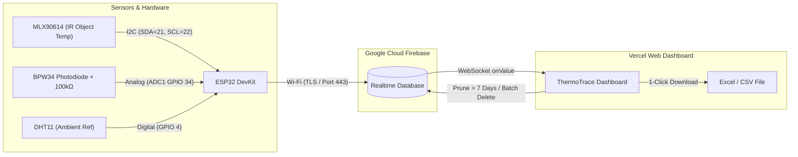

# ThermoTrace — Industrial Thermal & Optical Monitoring Lab

[](https://vercel.com)
[](https://firebase.google.com)
[](https://www.espressif.com)
[]()

**ThermoTrace** is an industrial-grade, non-contact temperature and optical radiation surveillance platform developed for continuous monitoring of the outer steel shell of industrial converters and heavy machinery in foundry operations.

By combining **MLX90614 infrared pyrometry**, **BPW34 silicon photodiode optical radiation detection**, and a **DHT11 ambient reference**, ThermoTrace detects thermal runaway trends, computes shell-to-ambient thermal gradients ($\Delta T$), and logs all telemetry to Firebase Realtime Database with live dashboard streaming, Excel/CSV export, and cloud storage management.

---

## 1. System Architecture



---

## 2. Hardware Wiring & Pinout Guide

### A. Pin Connection Table

| Sensor | Sensor Pin | ESP32 Pin | Wiring Description |
|:---|:---|:---|:---|
| **MLX90614** (Infrared Pyrometer) | **VIN** | **3.3V** (or **5V**) | Power supply (3.3V logic compatible) |
| | **GND** | **GND** | Ground reference |
| | **SCL** | **GPIO 22** | ESP32 Hardware I2C Clock |
| | **SDA** | **GPIO 21** | ESP32 Hardware I2C Data |
| **BPW34** (Silicon PIN Photodiode) | **Anode (+)** | **3.3V** | Positive terminal (longer lead / clear face) |
| | **Cathode (-)** | **GPIO 34** + **100kΩ** | Connect between photodiode (-) and 100kΩ resistor. Resistor connects to **GND** |
| **DHT11** (Environmental Reference) | **VCC** | **3.3V** | Power supply |
| | **GND** | **GND** | Ground reference |
| | **DATA** | **GPIO 4** | Digital data stream |

---

### B. Critical Hardware Rule: ESP32 ADC1 vs ADC2

> [!WARNING]
> **Why GPIO 34 was selected for the BPW34 Photodiode:**  
> On ESP32 microcontrollers, **ADC2 (GPIO 0, 2, 4, 12–15, 25–27) is shared with the Wi-Fi transceiver**. When Wi-Fi is actively transmitting data, `analogRead()` on ADC2 pins (like GPIO 25, 26, or 27) will fail or return garbage!  
> **Always use ADC1 pins (GPIO 32, 33, 34, 35, 36, 39)** for analog sensors when Wi-Fi is enabled. GPIO 34 is an ADC1 pin and functions with zero Wi-Fi interference.

---

### C. BPW34 Photodiode Circuit Schematic

```text
       3.3V
        │
       ┌┴┐
       │ │  BPW34 Photodiode (Anode +)
       └┬┘
        │   (Cathode -)
        ├──────────────────────────> To ESP32 GPIO 34 (Analog In)
        │
       ┌┴┐
       │ │  100 kΩ Resistor (Pull-down)
       └┬┘
        │
       GND
```

---

## 3. Web Dashboard Features

1. **Card 1: Machinery Surface Heat (MLX90614):**
   - Non-contact infrared temperature up to 600°C+
   - Proportional heat level bar
   - Sensor die ambient temperature reading
   - Real-time heat trend indicator ($\Delta T / \text{min}$)

2. **Card 2: Thermal Differential & Refractory Risk ($\Delta T$):**
   - Gradient: $\Delta T = T_{\text{machinery}} - T_{\text{ambient}}$
   - Automatic risk classification:
     - **NORMAL**: $\Delta T < 80^\circ\text{C}$
     - **ELEVATED**: $\Delta T \ge 80^\circ\text{C}$
     - **WARNING**: $\Delta T \ge 200^\circ\text{C}$
     - **CRITICAL**: $\Delta T \ge 400^\circ\text{C}$ (Refractory breakdown risk)

3. **Card 3: Optical Radiation Flux (BPW34):**
   - Incident optical radiation voltage ($0.00\text{V} - 3.30\text{V}$)
   - Optical radiation intensity index ($0 - 1000$)
   - Flame & thermal glow detection

4. **Card 4: Foundry Environment (DHT11):**
   - Ambient environmental temperature (°C)
   - Ambient relative humidity (%)

5. **Historical Telemetry & Storage Management:**
   - **All records stored permanently in Firebase Cloud** (no artificial 20-record limit).
   - **Time Range Filter:** All Time, Today Only, Past 24 Hours, Past 7 Days.
   - **Alert Filter:** All, Elevated+, Warning+, Critical Only.
   - **1-Click Export to Excel / CSV:** Downloads formatted `.csv` spreadsheet with full timestamps, temperatures, optical readings, and alert levels.
   - **Selective Deletion & Pruning:**
     - Select rows with checkboxes and click **Delete Selected** to free up Firebase cloud space.
     - Click **Prune > 7 Days** to safely clean up older logs.

---

## 4. Setup & Flashing Instructions

### STEP 1: Libraries in Arduino IDE
Open Arduino IDE and verify these libraries are installed:
- **`Adafruit MLX90614 Library`** by Adafruit
- **`DHT sensor library`** by Adafruit
- **`Firebase Arduino Client Library for ESP8266 and ESP32`** by Mobizt

### STEP 2: Open Firmware & Flash
1. Open [`firmware/dhtpulse_esp32.ino`](file:///d:/Project%20Works/testing%20iot/DHTPulse/firmware/dhtpulse_esp32.ino).
2. Board: **ESP32 Dev Module**.
3. Baud Rate: **115200**.
4. Click **Upload**.

### STEP 3: Observe Serial Monitor
```text
==================================================
             ThermoTrace TELEMETRY                
==================================================
WiFi: CONNECTED | Firebase: CONNECTED

Machinery Surface Temp (MLX): 185.4 °C
Ambient Temperature:          31.2 °C
Thermal Differential (ΔT):     154.2 °C
Environmental Humidity (DHT): 58 %
Optical Radiation (BPW34):    1.24 V (Index: 375)
Converter Thermal Status:     [ ELEVATED ]

Uploading telemetry to Firebase...
[ SUCCESS ] DATA SENT & STORED IN CLOUD HISTORICAL LEDGER
Next upload in 2 seconds...
==================================================
```

---

## 5. Deployment on Vercel

The web dashboard is ready for deployment:
```bash
npx vercel --prod
```
Framework Preset: **Other** | Output Directory: **`public`**.

---

## License
MIT License. Developed for industrial foundry converter monitoring and educational laboratory research.
