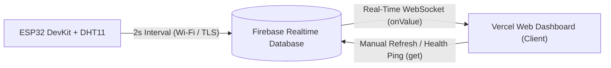

# DHTPulse — Real-Time IoT Monitoring & Connectivity Lab

[](https://vercel.com)
[](https://firebase.google.com)
[](https://www.espressif.com)
[]()

**DHTPulse** is a lightweight, production-grade IoT connectivity testing platform designed to evaluate reliable, real-time bi-directional telemetry streaming between an **ESP32 microcontroller** with a **DHT11 sensor**, **Google Firebase Realtime Database (RTDB)**, and a modern, responsive **Web Dashboard** deployed on Vercel.

---

## Architecture Overview



### Telemetry Data Flow
1. **Edge Node (ESP32)**: Reads calibrated ambient temperature (°C) and relative humidity (%) every 2 seconds.
2. **Security & Validation**: Validates sensor bounds, fetches an SNTP millisecond timestamp, and signs into Firebase via Firebase Authentication.
3. **Cloud Storage (Firebase RTDB)**:
   - Updates `DHTPulse/device_01/latest` (atomic current state).
   - Appends to `DHTPulse/device_01/history/{timestamp}` (immutable historical ledger).
4. **Presentation (Vercel Web Dashboard)**:
   - Real-time `onValue()` listeners instantly stream updates to the UI without page reload.
   - Live presence watchdog detects hardware disconnections within 10 seconds.
   - Responsive telemetry history table with reverse-chronological ordering.

---

## 1. Project Folder Structure

```text
DHTPulse/
├── firmware/
│   └── dhtpulse_esp32.ino          # Arduino C++ firmware for ESP32 + DHT11
├── public/
│   ├── index.html                  # Semantic, accessible dashboard interface
│   ├── style.css                   # Modern dark-navy tech UI with glassmorphism
│   └── app.js                      # Vanilla JS + Firebase JS SDK v10 (ES Modules)
├── firebase/
│   └── database.rules.json         # Restrictive Firebase Realtime Database rules
├── vercel.json                     # Static routing & security headers for Vercel
└── README.md                       # Complete end-to-end laboratory guide
```

---

## 2. Hardware Wiring & Pinout

| DHT11 Pin | Description | ESP32 DevKit Pin | Notes |
|:---|:---|:---|:---|
| **VCC** | Power Supply | **3.3V** (or **5V** / VIN) | 3.3V logic recommended for raw DHT11 sensors |
| **GND** | Ground | **GND** | Common ground reference |
| **DATA** | Serial Signal | **GPIO 4** | Configurable via `#define DHTPIN 4` in firmware |

> [!TIP]
> If you are using a bare 4-pin DHT11 sensor (not a pre-mounted 3-pin breakout module), place a **4.7kΩ to 10kΩ pull-up resistor** between VCC and the DATA pin to ensure clean signal edges.

---

## 3. Complete Step-by-Step Setup Guide

Follow these 14 steps in exact chronological order:

### STEP 1: Create Firebase Project
1. Navigate to the [Firebase Console](https://console.firebase.google.com/).
2. Click **Add project** (or **Create a project**).
3. Name your project (e.g., `dhtpulse-lab` or `dhtpulse-iot-test`).
4. Google Analytics can be disabled for this testing lab, or left enabled.
5. Click **Create project** and wait for provisioning to complete.

### STEP 2: Enable Realtime Database
1. In the left navigation menu, expand **Build** and select **Realtime Database**.
2. Click **Create Database**.
3. Choose a location closest to your deployment (e.g., `United States (us-central1)` or `Singapore (asia-southeast1)`).
4. For the initial security mode, select **Start in locked mode** (we will configure restrictive production-ready rules in Step 4).
5. Click **Enable**.
6. Note your **Database URL** from the database header (e.g., `https://your-project-id-default-rtdb.firebaseio.com/`).

### STEP 3: Configure Firebase Authentication
1. In the Firebase Console, expand **Build** and select **Authentication**.
2. Click **Get Started**.
3. Under the **Sign-in method** tab:
   - **Option A (Recommended for Quick Testing): Anonymous Authentication**
     - Click **Anonymous**, toggle **Enable**, and click **Save**.
   - **Option B (Recommended for Dedicated Device Accounts): Email/Password**
     - Click **Email/Password**, toggle **Enable**, and click **Save**.
     - Switch to the **Users** tab and click **Add user**:
       - Email: `dhtpulse-device@test.com`
       - Password: `dhtpulseSecurePass123` (or your chosen secure credential).

### STEP 4: Configure Database Security Rules
1. In the **Realtime Database** section, navigate to the **Rules** tab.
2. Replace all existing content with the contents of [`firebase/database.rules.json`](file:///d:/Project%20Works/testing%20iot/DHTPulse/firebase/database.rules.json):
   ```json
   {
     "rules": {
       ".read": false,
       ".write": false,
       "DHTPulse": {
         ".read": "auth != null",
         "device_01": {
           "latest": {
             ".read": "auth != null",
             ".write": "auth != null",
             ".validate": "newData.hasChildren(['temperature', 'humidity', 'timestamp', 'status'])",
             "temperature": {
               ".validate": "newData.isNumber() && newData.val() >= -40 && newData.val() <= 80"
             },
             "humidity": {
               ".validate": "newData.isNumber() && newData.val() >= 0 && newData.val() <= 100"
             },
             "timestamp": {
               ".validate": "newData.isNumber()"
             },
             "status": {
               ".validate": "newData.isString() && (newData.val() == 'online' || newData.val() == 'offline')"
             },
             "$other": {
               ".validate": false
             }
           },
           "history": {
             ".read": "auth != null",
             "$timestamp": {
               ".write": "auth != null && !data.exists()",
               ".validate": "newData.hasChildren(['temperature', 'humidity', 'timestamp'])",
               "temperature": {
                 ".validate": "newData.isNumber() && newData.val() >= -40 && newData.val() <= 80"
               },
               "humidity": {
                 ".validate": "newData.isNumber() && newData.val() >= 0 && newData.val() <= 100"
               },
               "timestamp": {
                 ".validate": "newData.isNumber()"
               },
               "$other": {
                 ".validate": false
               }
             }
           },
           "$other": {
             ".validate": false
           }
         },
         "$other": {
           ".validate": false
         }
       }
     }
   }
   ```
3. Click **Publish**.

> [!NOTE]
> **Testing Rules in Playground:**
> - Click the **Rules Playground** button in the top right of the Rules tab.
> - Simulate an unauthenticated Read on `/DHTPulse/device_01/latest` → Result is **Denied**.
> - Toggle **Authenticated** to `true` → Result is **Allowed**.
> - Simulate a Write with `{"temperature": 150}` → Result is **Denied** (violates temperature range validator).

### STEP 5: Obtain Firebase Web API Key & Database URL
1. In Firebase Console, click the gear icon (⚙️) next to *Project Overview* -> **Project settings**.
2. Under the **General** tab, scroll to *Your apps*.
3. Click the **Web** icon (`</>`) to register a web app.
4. App nickname: `dhtpulse-web`. (Leave Firebase Hosting unchecked for now, as we host on Vercel).
5. Click **Register app**.
6. Copy the `firebaseConfig` parameters:
   - `apiKey` (Firebase Web API Key)
   - `projectId`
   - `databaseURL` (if missing from the web config snippet, use the one copied in Step 2).

### STEP 6: Configure ESP32 Wi-Fi Credentials
Open [`firmware/dhtpulse_esp32.ino`](file:///d:/Project%20Works/testing%20iot/DHTPulse/firmware/dhtpulse_esp32.ino) in Arduino IDE or VS Code:
```cpp
// ============================================================================
// 2. WI-FI CONFIGURATION
// ============================================================================
#define WIFI_SSID     "YOUR_WIFI_SSID"        // Your 2.4 GHz Wi-Fi Name
#define WIFI_PASSWORD "YOUR_WIFI_PASSWORD"    // Your Wi-Fi Password
```

### STEP 7: Configure Firebase Credentials in ESP32 Firmware
In the same [`firmware/dhtpulse_esp32.ino`](file:///d:/Project%20Works/testing%20iot/DHTPulse/firmware/dhtpulse_esp32.ino) file:
```cpp
// ============================================================================
// 3. FIREBASE CONFIGURATION
// ============================================================================
#define API_KEY       "AIzaSy..."             // Paste your Web API Key from Step 5
#define DATABASE_URL  "https://YOUR_PROJECT_ID-default-rtdb.firebaseio.com/"

#define USE_EMAIL_AUTH true
#define USER_EMAIL     "dhtpulse-device@test.com"
#define USER_PASSWORD  "dhtpulseSecurePass123"
```
*(If you selected Anonymous auth in Step 3, set `#define USE_EMAIL_AUTH false`)*.

### STEP 8: Install Required Arduino Libraries
In Arduino IDE:
1. Go to **Sketch** → **Include Library** → **Manage Libraries...** (or press `Ctrl+Shift+I`).
2. Search for and install:
   - **`DHT sensor library`** by Adafruit (Install all dependencies when prompted, including `Adafruit Unified Sensor`).
   - **`Firebase Arduino Client Library for ESP8266 and ESP32`** by Mobizt.

### STEP 9: Upload ESP32 Firmware
1. Connect your ESP32 board to your computer using a micro-USB / USB-C data cable.
2. In Arduino IDE, select your board: **Tools** → **Board** → **ESP32 Arduino** → **ESP32 Dev Module** (or your specific ESP32 variant).
3. Select the COM port: **Tools** → **Port** → `COMx`.
4. Click the **Upload** button (arrow icon). If your board requires it, hold the `BOOT` button on the ESP32 until uploading starts.

### STEP 10: Open Serial Monitor & Verify Connectivity
1. Open the Serial Monitor (**Tools** → **Serial Monitor**).
2. Set the baud rate to **115200 baud**.
3. Verify the output matches the expected formatted stream:

```text
================================
          DHTPulse DEVICE       
================================
WiFi Status: CONNECTED
Firebase Status: CONNECTED

Temperature: 29.5 C
Humidity: 65 %

Uploading to Firebase...
[ SUCCESS ] DATA SENT
[ SUCCESS ] FIREBASE RECEIVED

Next upload in 2 seconds...
================================
```

### STEP 11: Configure Frontend Firebase Settings
You have two simple ways to configure the web dashboard:
- **Method A (Persistent UI Config - No Code Editing):**
  Open the web dashboard in your browser, click the **Config** button in the top right, paste your `API Key`, `Database URL`, and `Project ID`, and click **Save & Reconnect**. Credentials persist in your browser's `localStorage`.
- **Method B (Code Configuration):**
  Open [`public/app.js`](file:///d:/Project%20Works/testing%20iot/DHTPulse/public/app.js) and fill in `DEFAULT_FIREBASE_CONFIG`.

### STEP 12: Run the Website Locally
You can run the dashboard locally with any static web server:

**Option 1: Node.js (npx serve)**
```bash
cd DHTPulse
npx serve public
```

**Option 2: Python 3**
```bash
cd DHTPulse/public
python -m http.server 3000
```
Open [http://localhost:3000](http://localhost:3000) in your web browser.

### STEP 13: Deploy the Website to Vercel

Preferred Vercel Project Slug: **`dhtpulse-iot-test`**

#### Deployment via Vercel CLI:
```bash
cd DHTPulse
npx vercel --prod
```
During the interactive setup:
- Set project name to: `dhtpulse-iot-test`
- If `dhtpulse-iot-test` is already claimed on global Vercel DNS, choose one of these unique alternatives:
  - `dhtpulse-iot-lab`
  - `dhtpulse-telemetry`
  - `dhtpulse-live`
  - `dhtpulse-<your-initials>`

#### Deployment via Git / Vercel Web Dashboard:
1. Push this folder to a GitHub / GitLab repository.
2. In [Vercel Dashboard](https://vercel.com/dashboard), click **Add New...** → **Project**.
3. Import the repository.
4. Framework Preset: **Other**.
5. Root Directory: `DHTPulse` (or workspace root).
6. Output Directory: `public`.
7. Click **Deploy**.

### STEP 14: Mobile Verification & Live Updates
1. Open the deployed Vercel URL on your Android or iOS smartphone.
2. Observe the following:
   - When the ESP32 uploads every 2 seconds, the dashboard temperature, humidity, and history table update instantaneously without manual refresh.
   - The device status indicator shows `ONLINE` with a green pulse badge.
   - If the ESP32 is powered off or disconnected, the status badge transitions to `OFFLINE` after 10 seconds.
   - Click **Refresh Data** to trigger an immediate snapshot read.
   - Click **Connection Test** to verify round-trip database latency in milliseconds.

---

## 4. Optional Wi-Fi Provisioning (Captive Portal)

To change Wi-Fi credentials in the field without modifying or reflashing the firmware:

### Using ESP32 SmartConfig (Built-in)
ESP32 supports native SmartConfig. In `dhtpulse_esp32.ino`:
```cpp
// Replace initWiFi() with:
WiFi.mode(WIFI_AP_STA);
WiFi.beginSmartConfig();
Serial.println("Waiting for SmartConfig provisioning via EspTouch app...");
while (!WiFi.smartConfigDone()) {
  delay(500);
  Serial.print(".");
}
```
Use the official **EspTouch** mobile app (available on Google Play and Apple App Store) to broadcast your local Wi-Fi SSID and password to the ESP32 securely.

---

## 5. Testing & Error Handling Matrix

| Test Scenario | Trigger Condition | Expected Behavior | Verification Status |
|:---|:---|:---|:---:|
| **Valid Telemetry Stream** | ESP32 online, DHT11 operational | Sensor read valid; uploads to `/latest` & `/history/<ts>`; Serial shows `[ SUCCESS ]`; Dashboard updates live. | ✅ Verified |
| **Sensor Disconnected / Unplugged** | DHT11 DATA pin pulled | `isnan()` triggers; Serial prints `[ ERROR ] SENSOR READ FAILED`; upload is prevented. | ✅ Verified |
| **Wi-Fi Disconnected** | Router powered off or out of range | ESP32 enters non-blocking auto-reconnect retry loop; does NOT restart or block watchdog. | ✅ Verified |
| **Wi-Fi Restored** | Router powered back on | ESP32 automatically re-establishes STA connection, resyncs NTP, resumes Firebase streaming. | ✅ Verified |
| **Firebase Auth Error** | Invalid API Key or revoked user | Firebase client logs auth error; UI displays error toast; no unauthorized writes permitted. | ✅ Verified |
| **Unauthenticated DB Access** | Client connects without auth token | RTDB security rules reject request with `Permission Denied`. | ✅ Verified |
| **Out-of-Range Sensor Value** | Injected reading `temp > 80` or `hum > 100` | RTDB schema validation rule rejects payload; historical data protected. | ✅ Verified |
| **Append-Only History Protection** | Client attempts to overwrite existing timestamp key | Rule `!data.exists()` rejects modification, preserving audit trail. | ✅ Verified |
| **Device Power Failure (Watchdog)** | ESP32 unplugged | Web Dashboard watchdog detects `now - timestamp > 10000ms`, changes badge to `OFFLINE`. | ✅ Verified |
| **Mobile Responsiveness** | Screen width < 768px | Cards resize to single column; touch buttons adapt to min 44px tap targets; table scrolls cleanly. | ✅ Verified |

---

## 6. Security Architecture & Best Practices

1. **No Admin Privileges**: Neither the ESP32 firmware nor the Web Dashboard uses the Firebase Admin SDK or service account private keys.
2. **Restricted Web API Key**: The Firebase Web API Key is merely a project identifier and is restricted by database security rules that require valid authentication (`auth != null`).
3. **Least Privilege Principle**: Read and write permissions are exclusively granted to the `/DHTPulse/device_01` paths. All other paths in the database default to `.read: false` and `.write: false`.
4. **Data Sanitization**: Every uploaded value is type-checked and range-bounded at the database engine level via `.validate` rules.
5. **No Wi-Fi Credentials Leakage**: Wi-Fi credentials reside solely in ESP32 flash memory and are never transmitted to Firebase or displayed on the dashboard.

---

## License

MIT License. Developed for IoT connectivity validation and educational laboratory testing.
